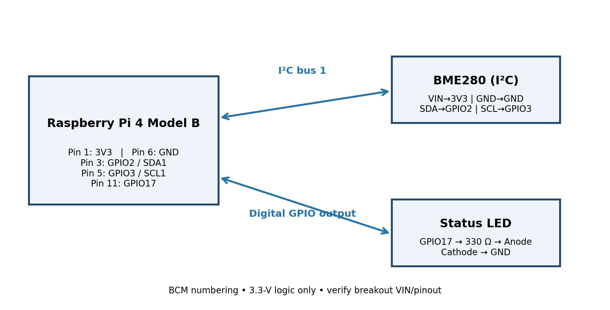
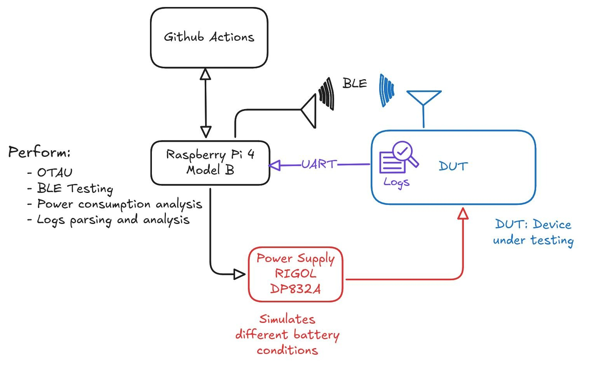
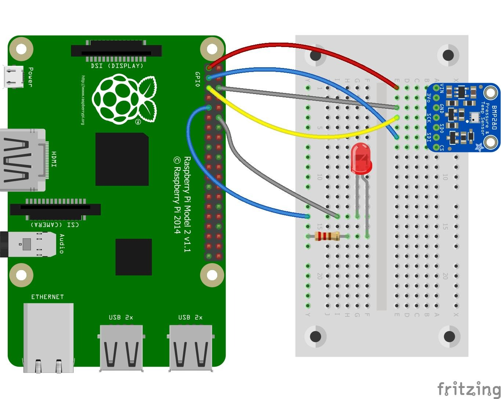
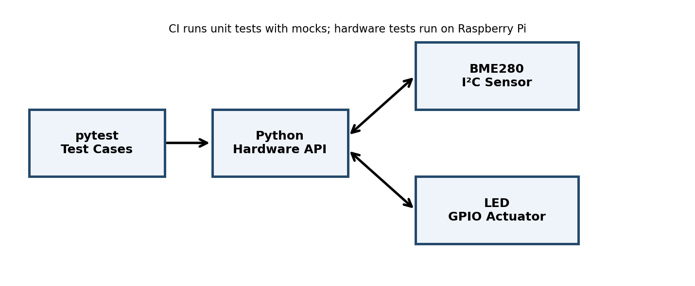

# Automated Hardware Test Rig — Raspberry Pi 4

**Python · Raspberry Pi OS · Bosch BME280 · I²C · GPIO · pytest · GitHub Actions**

A Raspberry Pi 4-based reference implementation for reading environmental data from a BME280 sensor and controlling a status LED. The software separates hardware access from testable application logic and provides hardware-independent unit tests.

> **Project status:** The supplied project report describes an adapted reference implementation. The Python unit tests can run without physical hardware. Actual sensor readings and GPIO hardware tests must be performed on a Raspberry Pi with the specified components connected; they are not claimed as completed measurements in this repository.

## Hardware configuration

| Component | Configuration | Purpose |
|---|---|---|
| Controller | Raspberry Pi 4 Model B | Linux / Python platform |
| OS | Raspberry Pi OS 64-bit | Operating system |
| Sensor | Bosch BME280 breakout | Temperature, relative humidity, pressure |
| Interface | I²C bus 1 | Sensor communication |
| Actuator | LED + 330 Ω resistor | Status indication |
| GPIO | BCM GPIO17 | LED control |

The BME280 breakout is intended to be compatible with 3.3 V logic. Verify the exact board pinout and input-voltage range before connecting it.

## Wiring

| Raspberry Pi header pin | Signal | Connection |
|---|---|---|
| Pin 1 | 3V3 | BME280 VIN/3V3 |
| Pin 6 | GND | BME280 GND |
| Pin 3 | GPIO2 / SDA1 | BME280 SDA |
| Pin 5 | GPIO3 / SCL1 | BME280 SCL |
| Pin 11 | GPIO17 | 330 Ω resistor → LED anode |
| Pin 9 | GND | LED cathode |



**Safety:** Raspberry Pi GPIO uses 3.3 V logic. Never apply 5 V to GPIO, SDA, or SCL. Use the LED series resistor. Do not connect motors, relays, or valves directly to GPIO.

## System design and implemented wiring

### Proposed system architecture

The following diagram documents a **planned system concept**, not a claim that all shown functions were implemented or validated. The concept includes a Raspberry Pi 4 controller, a device under test (DUT), UART/BLE communication, a Rigol DP832A programmable power supply for battery-condition simulation, and a possible GitHub Actions workflow. OTAU, BLE testing, power-consumption analysis, and log parsing/analysis are shown as planned capabilities only.



### Implemented BME280 and LED wiring

The following wiring illustration represents the BME280 and status-LED circuit that was implemented. The physical controller used for the project was a **Raspberry Pi 4 Model B**. The illustration itself is labelled Raspberry Pi Model 2, so it is included as a wiring reference rather than as a photograph or exact board-identification record.



## Software architecture



- `hardware/sensors.py` provides the BME280 adapter and `EnvironmentReading` data model.
- `hardware/actuators.py` provides the GPIO status LED adapter.
- `hardware/read_once.py` reads and prints one sensor sample.
- `hardware/led_demo.py` switches the status LED on and off.
- `tests/` contains unit tests and opt-in hardware tests.
- `.github/workflows/tests.yml` runs hardware-independent tests on push and pull request.

## Setup on Raspberry Pi OS

```bash
sudo raspi-config  # enable I2C under Interface Options
sudo apt update
sudo apt install -y python3-venv python3-pip i2c-tools

i2cdetect -y 1
```

The BME280 commonly responds at address `0x76` or `0x77`. Set the detected address in `config/settings.json`.

```bash
python3 -m venv .venv
source .venv/bin/activate
pip install -r requirements.txt
```

## Run the software

```bash
python -m hardware.read_once
python -m hardware.led_demo
```

## Run tests

Hardware-independent tests:

```bash
pytest -m "not hardware" --cov=hardware --junitxml=reports/junit-unit.xml
```

Physical hardware tests (run only on the Raspberry Pi after checking the wiring):

```bash
HARDWARE_TESTS=1 pytest -m hardware -v --junitxml=reports/junit-hardware.xml
```

GitHub Actions runs only the hardware-independent tests on a cloud runner. A cloud runner does not have access to the physical Raspberry Pi GPIO or I²C bus.

## Repository structure

```text
.
├── .github/workflows/tests.yml
├── config/settings.json
├── docs/
│   ├── architecture.png
│   ├── wiring_diagram.png
│   ├── test_plan.md
│   └── acceptance_criteria.md
├── hardware/
├── scripts/
├── tests/
├── pytest.ini
├── requirements.txt
└── README.md
```

## Test status from package review

The included test suite was executed in a non-hardware environment: **8 passed, 2 skipped**. The two skipped tests require a physical Raspberry Pi, BME280 sensor, and LED circuit. This result does not represent a completed hardware-in-the-loop test.
